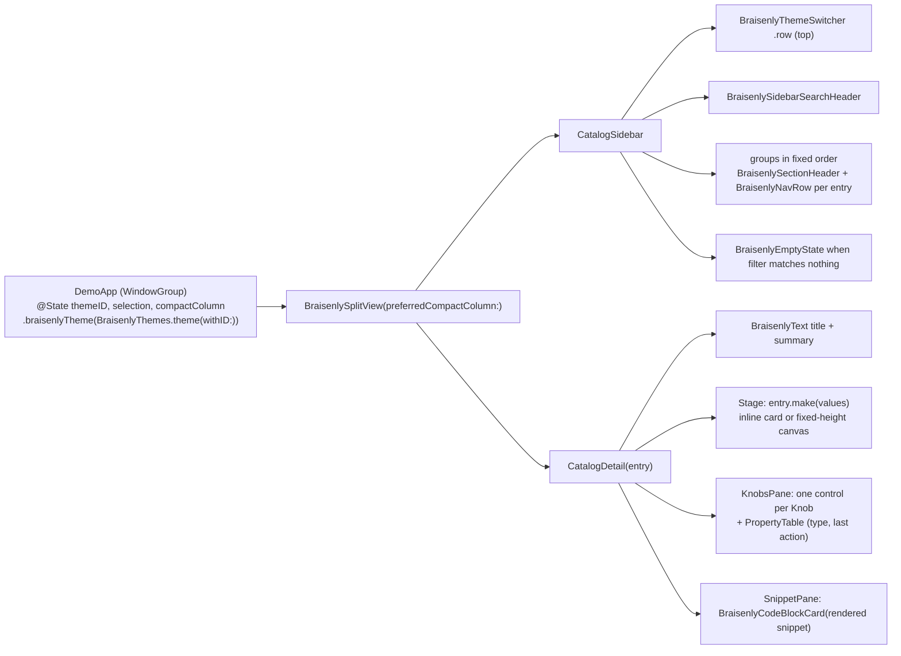

# BraisenlySwiftDemo catalog — design spec

Date: 2026-11-08. Author: Architect (demo side), team BSD-001 "Catalog Build Wing". Status: draft for user approval.
Binding inputs: coordinator plan `use-superpowers-and-caveman-prancy-matsumoto.md` (decisions U-1..U-13, D-4, D-5, D-6, D-8, D-9),
inventory `docs/catalog-inventory.md` (ai-chat-components 8570eb1), package spec
`BraisenlySwiftUI-catalog/docs/superpowers/specs/2026-11-08-themable-tokens-and-catalog-primitives-design.md` (package 0.2.0,
read 2026-11-08 12:12; "package spec §n" below). Companion: `2026-11-08-ai-catalog-design.md` (AI group, lockstep).
Builder check (fresh subagent, 2026-11-08) answers are folded in; see §17.

## 1. Intent

BraisenlySwiftDemo is to BraisenlySwiftUI what Storybook is to a React design system. A grouped sidebar lists every public
primitive, compound component, modifier and token family of the package. Selecting one shows a title and summary, a live
stage that renders the real component, a knobs pane whose typed controls mutate the component's parameters, and a code
snippet that tracks the knob values. The app is built only from package components, so switching the theme (Liquid Glass,
Solarized Light, Solarized Dark) re-themes the catalog chrome and the stage together. Anything the demo needs that the
package lacks is added to the package, never to the demo.

## 2. Goals, non-goals, anti-goals

Goals
- G-1 Every public `View`/`ViewModifier` type exported by module `BraisenlySwiftUI` has exactly one catalog entry; a unit test
  fails when the package gains a type the catalog lacks, or the catalog names a type the package no longer exports.
- G-2 Every entry has at least one knob (U-2). Knobs cover every public init parameter that is not a closure or binding.
- G-3 One multiplatform target runs on iPadOS 26+ (presto), iPhone (hemoila, compact) and macOS 26+ (largo) (U-4), physical
  devices only (D-9).
- G-4 Zero bare SwiftUI in `Sources/` (U-3), enforced by `scripts/dogfood-lint.sh` in `check.sh` and as a pre-build phase.
- G-5 A UI test walks every entry in every theme and attaches one screenshot per (entry, theme).
- G-6 The AI group is specced now and plugs into the same registry behind `BRAISENLY_AI` (U-1, U-8, D-8).

Non-goals
- No snapshot-testing dependency and no pixel comparison (U-11). Screenshots are evidence, so animated content (pulse
  indicator, caret) needs no freezing switch.
- No preview macros, reflection or code generation for entries; the registry is explicit typed Swift.
- No persistence of knob values across launches; no deep links beyond the launch arguments in §9.
- No AI entries in this build (U-1): the AI target compiles with an empty AI group.

Anti-goals (a change that does any of these is rejected)
- AG-1 Any bare SwiftUI view, control, layout container, font or color literal in `Sources/`, including layout (U-3).
  Banned constructs are exactly the D-5 regex (§10). Allowed: `App`, `WindowGroup`, `Scene`, `@State`, `@Binding`,
  `@Environment`, `@Observable`, `ForEach`, `Group`, `AnyView`, `#if os(...)`, `#if BRAISENLY_AI`, `Binding(get:set:)`,
  platform pasteboard calls (`NSPasteboard`/`UIPasteboard`, snippet copy only), and non-visual or package modifiers:
  `.accessibilityLabel/Identifier/Value/Element`, `.frame`, `.id`, `.onChange`, `.task`, `.sheet`, `.braisenlyTheme`,
  `.braisenlyCard`, `.braisenlyCapsule`, `.braisenlyPadding`, `.braisenlySheetBackground`.
- AG-2 A component, wrapper or token defined inside the demo. Missing building blocks are filed against the package.
- AG-3 Any simulator destination in scripts, tests or docs. Scripts refuse `platform=iOS Simulator` (exit 2).
- AG-4 Team id, UDID, bundle prefix or package path outside `.env` (Config SSoT).

## 3. Dependencies and order

- The package's 0.2.0 work (theme model, layout wrappers, controls, `BraisenlyButton`, `BraisenlyThemeSwitcher`, removal of
  `BraisenlyTheme`/`BraisenlyThemeToggle`) lands on the package worktree before demo Task 1 starts (coordinator plan
  Phase 2 gate precedes Phase 3). Demo builders never edit the package. A missing or different package API is reported to
  the coordinator as a package gap and the dependent demo task stops (`blocked`), it is not worked around.
- During development `BRAISENLY_PACKAGE_PATH=../BraisenlySwiftUI-catalog`; after the package PR merges, `../BraisenlySwiftUI`
  (`.env.example` default).

## 4. Package contract consumed (package spec 0.2.0, reconciled)

| Area | Names the demo uses (package spec section) |
|---|---|
| Theme (§4.4) | `BraisenlyThemeDefinition { id, name, symbolName, colorScheme, colors, typography, metrics, surface }`; `BraisenlyThemes.liquidGlass/solarizedLight/solarizedDark/all`; ids `"liquidGlass"`, `"solarizedLight"`, `"solarizedDark"`; `BraisenlyThemes.theme(withID:in:)` (unknown id → liquidGlass, never traps); `EnvironmentValues.braisenlyTheme`; `View.braisenlyTheme(_:)` sets the environment, `preferredColorScheme(theme.colorScheme)` and `.tint(accentTeal)` |
| Colors (§4.2) | `BraisenlyColorTokens`: backgroundPrimary, backgroundDimmed, surfaceSheet, surfaceElevated, surfaceHighlight, surfaceSnippet, borderSubtle, divider, accentTeal, textPrimary, textBright, textSecondary, textDisabled, matchBackground, matchForeground, danger, warning, success, scrim, shadow (20) |
| Solarized | `BraisenlyDS.Solarized.{base03,base02,base01,base00,base0,base1,base2,base3,yellow,orange,red,magenta,violet,blue,cyan,green}` (unchanged statics) |
| Typography (§4.2, §8) | `BraisenlyTypographyTokens` (14 fonts); `BraisenlyTextStyle` cases documentTitle, vaultTitle, bodyReading, rowLabel, rowLabelMedium, snippetBody, metadata, badgeNumber, code, labelEmphasis, chipLabel, `font(in:)`; `BraisenlyTone` cases primary, bright, secondary, disabled, accent, danger, warning, success; `BraisenlyIconSize` small, medium, large |
| Metrics (§4.1–4.2) | `BraisenlyStep` zero, xs, s, m, l, xl; `BraisenlyScale` subscript by step; `BraisenlyMetricTokens { spacing, radius: BraisenlyScale; circleButtonSize, toolbarHeight, rowHeight, sidebarWidthRatio, hairline, sheetCornerRadius: CGFloat; grabberSize: CGSize }` |
| Surface (§4.3, §5) | `BraisenlySurfaceStyle.glass(Glass)/.solid`; `BraisenlySurfaceRole.content/.control/.chrome`; `BraisenlyCardModifier(cornerRadius: CGFloat? = nil, fill: Color? = nil, role: = .content)`; `BraisenlyCapsuleModifier(fill: Color? = nil, role: = .control)`; `braisenlyCard(cornerRadius:fill:role:)`, `braisenlyCapsule(fill:role:)`, `braisenlySheetBackground()` |
| Layout (§8) | `BraisenlyVStack(alignment:spacing: BraisenlyStep = .m, content:)`, `BraisenlyHStack(alignment:spacing:content:)`, `BraisenlyZStack(alignment:content:)`, `BraisenlySpacer(minLength: BraisenlyStep? = nil)`, `BraisenlyDivider()`, `braisenlyPadding(_ edges: Edge.Set = .all, _ step: BraisenlyStep = .m)`, `BraisenlyScroll(_ axes:showsIndicators:content:)`, `BraisenlyGrid(minimumColumnWidth: CGFloat = 160, spacing: BraisenlyStep = .m, content:)`, `BraisenlySplitView(columnVisibility:preferredCompactColumn:extendsDetailBackground:sidebar:detail:)`, `BraisenlyText(_:style:tone:)`, `BraisenlyIcon(systemName:size:tone:)` |
| Controls (§9, §10) | `BraisenlySectionHeader(_ title:systemImage:trailing:)`, `BraisenlyNavRow(title:systemImage:badge:isSelected:platform:action:)`, `BraisenlySegmentedControl(selection:options:title:platform:)`, `BraisenlyToggleRow(_ title:subtitle:isOn:)`, `BraisenlyStepperRow(_ title:value:in:step:)`, `BraisenlyTextFieldRow(_ title:text:prompt:axis:)`, `BraisenlyChipGroup(selection:options:title:)`, `BraisenlyColorSwatch(color:name:detail:isSelected:action:)`, `BraisenlyPropertyTable(rows: [BraisenlyPropertyTable.Row(key:value:)])`, `BraisenlyEmptyState(title:message:systemImage:actionTitle:action:)`, `BraisenlyButton(_ title:systemImage:prominence:action:)` with `BraisenlyButtonProminence.standard/.prominent`, `BraisenlyThemeSwitcher(selection:themes:style:platform:)` with `BraisenlyThemeSwitcherStyle.row/.cycle` |
| Migrated views (§6) | colour/radius/font params become optional overrides (`nil` = theme): AvatarBadge colours, BannerCard `iconColor` (→ `danger`), ChatBubbleSurface `fill/foregroundColor/cornerRadius`, HighlightedText `font/baseColor`, PromptField `cornerRadius/fill`, StatusCard `iconColor`. Theme params become `Binding<BraisenlyThemeDefinition.ID>` (DocumentChrome, DocumentCanvas, CompactWorkspace, RegularWorkspace) and `initialTheme: BraisenlyThemeDefinition.ID` (MobileWorkspaceView) |
| Removed (§7) | `BraisenlyTheme`, `BraisenlyThemeToggle` (no entry) |

Reduce Transparency and Reduce Motion are honoured inside the package (glass → solid, gated animations); the demo
verifies them live (§13).

## 5. Information architecture



Sidebar
- Order: `BraisenlyThemeSwitcher(selection: $themeID, style: .row)` (identifier `catalog.themeSwitcher`),
  `BraisenlySidebarSearchHeader(searchText:)` (identifier `catalog.search`), then groups in `CatalogGroup.allCases` order:
  Tokens, Layout, Modifiers, Buttons & Pills, Indicators, Fields, Controls, Cards, Rows & Groups, Sidebar, Document,
  Workspaces (AI last, AI scheme only).
- Each group: `BraisenlySectionHeader(group.title, systemImage: group.symbolName, trailing: "\(count)")`, then one
  `BraisenlyNavRow(title: entry.title, isSelected: entry.id == selection) { select(entry) }` per entry, identifier
  `catalog.row.<entry.id>`, in group-file order.
- Search: whitespace-trimmed query; empty shows everything; otherwise `localizedStandardContains` (case- and
  diacritic-insensitive) over `title`, `typeName`, `summary`; groups without matches are hidden; zero matches shows
  `BraisenlyEmptyState(title: "No components", message: "Nothing matches “<query>”.", systemImage: "magnifyingglass")`.
- The sidebar content sits in one `BraisenlyScroll`.

Detail (`CatalogDetail`, identifier `catalog.detail`, `accessibilityValue` = entry id)
- `BraisenlyScroll { BraisenlyVStack(alignment: .leading, spacing: .l) { header; stage; knobs; snippet }.braisenlyPadding(.all, .l) }`,
  content width capped at the resolved `BraisenlyPlatform.contentMaxWidth`.
- Header: `BraisenlyText(entry.title, style: .documentTitle)`, `BraisenlyText(entry.summary, style: .bodyReading, tone: .secondary)`.
- Stage (identifier `catalog.stage`): `.inline` → content centred with `.braisenlyPadding(.all, .l)` inside `.braisenlyCard()`,
  `.frame(minHeight: 160)`; `.canvas(height:)` → full width, `.frame(height:)`, clipped, inside `.braisenlyCard()`.
  `.accessibilityElement(children: .contain)`, label "Live preview of <title>".
- Knobs pane: `BraisenlySectionHeader("Knobs", systemImage: "slider.horizontal.3")`, one control per knob (§7), then
  `BraisenlyPropertyTable(rows: [Row(key: "Type", value: typeName ?? "Token"), Row(key: "Last action", value: log.last ?? "—")])`.
- Snippet pane: `BraisenlySectionHeader("Code", systemImage: "chevron.left.forwardslash.chevron.right")`,
  `BraisenlyCodeBlockCard(language: "swift", code: entry.renderSnippet(values), onCopy: copySnippet)` (identifier
  `catalog.snippet`). `copySnippet` writes the string with `NSPasteboard.general` on macOS and `UIPasteboard.general` on iOS
  (`#if os(macOS)`), then records "Copied snippet" in the action log.
- No selection: `BraisenlyEmptyState(title: "Pick a component", message: "Choose an entry in the sidebar.", systemImage: "sidebar.leading")`.
- The detail is keyed `.id(entry.id)`: knob values, bound stage state and the action log reset when the entry changes and
  persist across theme changes and knob edits.

Theme: one switcher, at the top of the sidebar. It drives `@State themeID` in `DemoApp`; the root applies
`.braisenlyTheme(BraisenlyThemes.theme(withID: themeID))`, which also sets the window's colour scheme and tint, so chrome and
stage switch together.

Regular vs compact
- iPad (regular) and macOS: two-column split; sidebar visible; selection updates the detail.
- iPhone (compact): the split collapses. `DemoApp` owns `@State compactColumn: NavigationSplitViewColumn = .sidebar`, passed
  as `preferredCompactColumn`; selecting a row sets `.detail`; the system back control returns. A launch-argument entry
  starts on `.detail`.
- Navigation containers nested in the detail (entries `layout.splitView`, `workspaces.regular`, `workspaces.compact`,
  `sidebar.drawer`) render inside a fixed-height canvas. If nesting breaks the app's own sidebar or back navigation on any
  destination (UI test `testSplitViewEntryDoesNotTrapNavigation`), the fix is a package change (e.g. a non-navigating
  container option on the affected component), filed through the coordinator; the entry is not dropped.

## 6. Catalog model (code-level)

All demo code: Swift 6 language mode, `SWIFT_DEFAULT_ACTOR_ISOLATION = MainActor`, `SWIFT_APPROACHABLE_CONCURRENCY = YES`.

```swift
enum CatalogGroup: String, CaseIterable, Identifiable {
    case tokens, layout, modifiers, buttonsPills, indicators, fields, controls, cards, rowsGroups, sidebar, document, workspaces
    #if BRAISENLY_AI
    case ai
    #endif
    var id: String { rawValue }
    var title: String        // "Tokens", "Layout", "Modifiers", "Buttons & Pills", "Indicators", "Fields", "Controls",
                             // "Cards", "Rows & Groups", "Sidebar", "Document", "Workspaces", "AI"
    var symbolName: String   // "paintpalette", "square.grid.3x1.below.line.grid.1x2", "wand.and.stars", "capsule",
                             // "dot.radiowaves.left.and.right", "character.cursor.ibeam", "slider.horizontal.3",
                             // "rectangle.on.rectangle", "list.bullet", "sidebar.left", "doc.text", "macwindow", "sparkles"
}

enum EntryPresentation: Equatable { case inline, canvas(height: CGFloat) }

struct CatalogEntry: Identifiable {
    let id: String                 // "<group.rawValue>.<lowerCamelName>", e.g. "buttonsPills.circleIconButton"
    let group: CatalogGroup
    let typeName: String?          // exact public type name for View/ViewModifier entries; nil for token/concept entries
    let title: String
    let summary: String
    let snippet: String            // Swift source with {{knobKey}} placeholders
    let knobs: [Knob]              // >= 1 (U-2)
    var presentation: EntryPresentation = .inline
    let make: (KnobValues) -> AnyView
    func renderSnippet(_ values: KnobValues) -> String
}

enum Knob: Identifiable {
    case bool(key: String, label: String, default: Bool)
    case int(key: String, label: String, range: ClosedRange<Int>, default: Int)
    case double(key: String, label: String, range: ClosedRange<Double>, step: Double, default: Double)
    case pick(key: String, label: String, options: [String], default: String)
    case text(key: String, label: String, default: String)
    case color(key: String, label: String, options: [ColorToken], default: ColorToken)
    var id: String { key }
    var key: String
    var label: String
    var defaultValue: KnobValue
    static func platform(default: String = "automatic") -> Knob                         // pick "platform": automatic/iPhone/iPad/mac
    static func step(key: String = "spacing", label: String = "Spacing", default: String = "m") -> Knob // BraisenlyStep raw values
    static func textStyle(key: String = "style", label: String = "Text style", default: String = "rowLabel") -> Knob // 11 raw values
    static func tone(key: String = "tone", default: String = "primary") -> Knob          // BraisenlyTone raw values
}

enum KnobValue: Hashable { case bool(Bool), int(Int), double(Double), string(String), color(ColorToken) }

enum ColorToken: String, CaseIterable {
    case backgroundPrimary, backgroundDimmed, surfaceSheet, surfaceElevated, surfaceHighlight, surfaceSnippet, borderSubtle,
         divider, accentTeal, textPrimary, textBright, textSecondary, textDisabled, matchBackground, matchForeground,
         danger, warning, success, scrim, shadow                                          // 20 theme tokens
    case solarizedBase03, solarizedBase02, solarizedBase01, solarizedBase00, solarizedBase0, solarizedBase1, solarizedBase2,
         solarizedBase3, solarizedYellow, solarizedOrange, solarizedRed, solarizedMagenta, solarizedViolet, solarizedBlue,
         solarizedCyan, solarizedGreen                                                     // 16 constants
    static var themeTokens: [ColorToken]      // first 20
    static var solarized: [ColorToken]        // last 16
    func color(in theme: BraisenlyThemeDefinition) -> Color
    var snippetExpression: String             // "theme.colors.accentTeal" / "BraisenlyDS.Solarized.red"
}

@Observable final class ActionLog { private(set) var last: String?; private(set) var count = 0; func record(_ name: String); func clear() }

struct KnobValues {
    init(knobs: [Knob], theme: BraisenlyThemeDefinition, log: ActionLog)   // seeded with each knob's default
    var theme: BraisenlyThemeDefinition
    private(set) var missingKeys: Set<String>                             // keys read but never declared
    subscript(key: String) -> KnobValue? { get set }
    func bool(_ key: String) -> Bool
    func int(_ key: String) -> Int
    func double(_ key: String) -> Double
    func string(_ key: String) -> String                                 // pick and text knobs
    func optionalString(_ key: String) -> String?                        // "" -> nil
    func color(_ key: String) -> Color                                   // ColorToken resolved in `theme`
    func action(_ name: String) -> () -> Void                            // records `name` in the ActionLog
    func platform(_ key: String = "platform") -> BraisenlyPlatform
    func step(_ key: String = "spacing") -> BraisenlyStep
    func textStyle(_ key: String = "style") -> BraisenlyTextStyle
    func tone(_ key: String = "tone") -> BraisenlyTone
    func font(_ key: String) -> Font                                     // textStyle(key).font(in: theme.typography)
}

struct StateHost<Value, Content: View>: View {
    init(_ initial: Value, @ViewBuilder content: @escaping (Binding<Value>) -> Content)   // @State value; body = content($value)
}

enum CatalogRegistry {
    static var all: [CatalogEntry]                                       // group arrays in CatalogGroup.allCases order
    static func entries(in group: CatalogGroup) -> [CatalogEntry]
    static func entry(id: String) -> CatalogEntry?
    static func sections(matching query: String, in entries: [CatalogEntry] = all) -> [(group: CatalogGroup, entries: [CatalogEntry])]
}
```

Reading knobs in `make`
- `make` reads every knob value into locals before building the view, so a misspelled key lands in `missingKeys` when `make`
  runs. Reading a missing key returns a zero value (`false`, `0`, `0.0`, `""`, `ColorToken.textPrimary`, first enum case)
  and inserts the key; it never traps. Pick values that do not parse into their enum fall back to the first case.
- `values.action("onSend")` returns a closure recording `"onSend"`. Every closure parameter is wired this way; an optional
  closure gets `nil` only when a bool knob in the entry says so.
- `Binding` parameters: wrap in `StateHost(initial) { $value in ... }`; multi-binding components use one private `struct`
  per entry as `Value` (e.g. `SidebarDrawerState { searchText, mode, showPopover }`). Bound values are live stage state,
  not knobs.

Snippet rendering: every `{{key}}` becomes the Swift literal of the current value: text → escaped string literal (`\\`, `\"`,
`\n`, `\t`); bool/int → literal; double → `String(describing:)`; pick → raw option (snippets write `.{{platform}}` where an
enum case is expected); color → `ColorToken.snippetExpression`. Unknown placeholders stay verbatim.

Fixtures (`Sources/Catalog/Fixtures.swift`, no model loads, no I/O): `documentText` (3 short paragraphs mentioning "glass"),
`searchParagraph`, `codeSample` (6 lines of Swift using `.braisenlyCard()`), `actionItems` (6 `BraisenlyActionItem`: pin "Pin",
rename "Rename", share "Share", duplicate "Duplicate", archive "Archive" checked, trash "Delete"), `modelNames` (["LFM3 1.7B",
"Qwen3.5 4B", "Gemma4 E4B", "Apple On-Device", "Claude Sonnet", "GPT-4o", "LFM3 Omni", "LFM3 bf16"]), `propertyRows`
(8 `BraisenlyPropertyTable.Row`s), `segmentOptions` (["Files","Search","Tags","Bookmarks","All"]). Group-only fixtures are
`private` constants in their group file.

## 7. Knob rendering (KnobsPane)

| Knob | Control |
|---|---|
| bool | `BraisenlyToggleRow(label, isOn:)` |
| int | `BraisenlyStepperRow(label, value:, in: range)` |
| double | `BraisenlyParameterSliderRow(title: label, value:, in: range, step: step, formatString: step < 0.1 ? "%.2f" : step < 1 ? "%.1f" : "%.0f")` |
| pick, ≤ 4 options | `BraisenlyText(label, style: .metadata, tone: .secondary)` above `BraisenlySegmentedControl(selection:, options:, title: { $0 })` |
| pick, > 4 options | same label above `BraisenlyChipGroup(selection:, options:, title: { $0 })` |
| text | `BraisenlyTextFieldRow(label, text:)` (`axis: .vertical` when the default contains a newline) |
| color | label above `BraisenlyGrid(minimumColumnWidth: 56, spacing: .s)` of `BraisenlyColorSwatch(color: token.color(in: theme), name: token.rawValue, isSelected: token == current) { select(token) }` |

Every knob control: `.accessibilityIdentifier("knob.<key>")`, `.accessibilityLabel(label)`. Bindings are
`Binding(get:set:)` over the detail's `@State var values: KnobValues`.

## 8. Entry specification (exhaustive)

Notation: `key: kind(default; range or options)`. "log" = `values.action(<param name>)`. `platform` = `Knob.platform()`;
`spacing` = `Knob.step()`; `style` = `Knob.textStyle()`; `tone` = `Knob.tone()`. Colour knobs list `all` (36) or `theme` (20)
options. Inline unless marked canvas. typeName "—" = nil. Table order = sidebar order. **71 entries: 60 typed + 11 token/concept.**

### 8.1 Tokens (`TokensEntries.swift`) — typeName —

| id | Title | Knobs | Stage |
|---|---|---|---|
| tokens.solarizedPalette | Solarized Palette | minColumnWidth: double(96; 48…240; 8), showNames: bool(true) | `BraisenlyGrid` of 16 swatches (`ColorToken.solarized`) |
| tokens.colors | Color Tokens | minColumnWidth: double(96; 48…240; 8), showNames: bool(true), theme: pick(app; app/liquidGlass/solarizedLight/solarizedDark) | 20 swatches (`themeTokens`); non-"app" applies `.braisenlyTheme(BraisenlyThemes.theme(withID:))` to the stage only |
| tokens.typography | Typography | sample: text("The quick brown fox jumps over the lazy dog") | one `BraisenlyText(sample, style:)` per `BraisenlyTextStyle` (11) with the style name as metadata caption |
| tokens.metrics | Metrics & Scales | step: Knob.step(key: "step", label: "Step") | PropertyTable of the scalar metrics, `spacing[step]`, `radius[step]`; two capsules separated by `spacing[step]`; a card with `radius[step]` |
| tokens.platformDensity | Platform Density | platform (default "iPad") | PropertyTable controlSize, rowHeight, contentMaxWidth |
| tokens.themeDefinitions | Theme Definitions | theme: pick(liquidGlass; 3 ids) | PropertyTable id, name, symbolName, colorScheme ("system" when nil), surface ("glass"/"solid") |

### 8.2 Layout (`LayoutEntries.swift`)

| id | typeName | Knobs | Stage |
|---|---|---|---|
| layout.vStack | BraisenlyVStack | spacing, alignment: pick(center; leading/center/trailing), itemCount: int(3; 1…6) | items `BraisenlyText("Item n").braisenlyCapsule()` |
| layout.hStack | BraisenlyHStack | spacing, alignment: pick(center; top/center/bottom), itemCount: int(3; 1…6) | same items |
| layout.zStack | BraisenlyZStack | alignment: pick(center; topLeading/center/bottomTrailing), layerCount: int(3; 1…4) | layered capsules |
| layout.scroll | BraisenlyScroll | axis: pick(vertical; vertical/horizontal), itemCount: int(20; 5…50), showsIndicators: bool(true) | `.frame(height: 240)` |
| layout.spacer | BraisenlySpacer | minLength: pick(none; none/zero/xs/s/m/l/xl) | HStack "Leading" · spacer · "Trailing" |
| layout.divider | BraisenlyDivider | context: pick(vertical stack; vertical stack/horizontal stack) | divider between two texts |
| layout.text | BraisenlyText | text: text("Braisenly"), style, tone | single text |
| layout.icon | BraisenlyIcon | systemName: text("sparkles"), size: pick(medium; small/medium/large), tone | single icon |
| layout.grid | BraisenlyGrid | minimumColumnWidth: double(120; 40…320; 10), itemCount: int(9; 1…24), spacing | capsules "1"…"n" |
| layout.splitView | BraisenlySplitView | compactColumn: pick(sidebar; sidebar/detail), extendsDetailBackground: bool(false) | canvas(height: 420); sidebar of 3 NavRows, EmptyState detail |

### 8.3 Modifiers (`ModifiersEntries.swift`)

| id | typeName | Knobs | Stage |
|---|---|---|---|
| modifiers.braisenlyCard | BraisenlyCardModifier | content: text("Card content"), cornerRadius: double(20; 0…48; 1), fill: color(surfaceElevated; theme), role: pick(content; content/control/chrome) | `BraisenlyText(content, style: .bodyReading).braisenlyPadding(.all, .l).braisenlyCard(cornerRadius:fill:role:)` |
| modifiers.braisenlyCapsule | BraisenlyCapsuleModifier | content: text("Capsule"), fill: color(surfaceElevated; theme), role: pick(control; content/control/chrome) | `.braisenlyCapsule(fill:role:)` |
| modifiers.braisenlyPadding | — | edges: pick(all; all/horizontal/vertical/top/bottom/leading/trailing), step: Knob.step(key: "step", label: "Step") | text in a capsule, padded |
| modifiers.braisenlyTheme | — | theme: pick(solarizedDark; 3 ids) | StatusCard + CircleIconButton with `.braisenlyTheme(...)` on the stage subtree only |
| modifiers.glassSurfaces | — | surface: pick(glass; glass/solid), glass: pick(regular; regular/clear/identity), role: pick(control; content/control/chrome) | card + capsule under a copy of `values.theme` with `surface` overridden, showing the `glass(for:)` truth table |
| modifiers.braisenlySheetBackground | — | title: text("Sheet") | `BraisenlyButton("Present sheet")` toggling StateHost(false) `.sheet(isPresented:)` whose content (`BraisenlyText(title)` + close button) uses `.braisenlySheetBackground()` |

### 8.4 Buttons & Pills (`ButtonsPillsEntries.swift`)

| id | typeName | Knobs | Closures / state |
|---|---|---|---|
| buttonsPills.button | BraisenlyButton | title: text("Continue"), systemImage: text("arrow.right") ("" → nil), prominence: pick(standard; standard/prominent) | action log |
| buttonsPills.circleIconButton | BraisenlyCircleIconButton | systemName: text("plus"), accessibilityLabel: text("Add"), iconSize: double(18; 10…32; 1), platform | action log |
| buttonsPills.toolbarIconButton | BraisenlyToolbarIconButton | systemName: text("square.and.arrow.up"), label: text("Share"), isEnabled: bool(true) | action log |
| buttonsPills.sendStopButton | BraisenlySendStopButton | isResponding: bool(false), canSend: bool(true), size: double(44; 24…72; 2) | onSend, onCancel log |
| buttonsPills.dualActionPill | BraisenlyDualActionPill | platform | onEdit, onMore log |
| buttonsPills.messageActionPill | BraisenlyMessageActionPill | isCopied: bool(false), canRegenerate: bool(true) | onCopy, onRegenerate log |
| buttonsPills.modelPill | BraisenlyModelPill | title: text("LFM3 1.7B"), systemImage: text("cpu"), tappable: bool(true) | action log when tappable, else nil |
| buttonsPills.citationPill | BraisenlyCitationPill | title: text("Swift Evolution"), source: text("swift.org") ("" → nil), hasURL: bool(true) (→ `https://www.swift.org`), systemImage: text("link") | — |
| buttonsPills.themeSwitcher | BraisenlyThemeSwitcher | style: pick(row; row/cycle), includeLiquidGlass: bool(true), platform | StateHost("solarizedLight"); stage-local, never changes the app theme |

### 8.5 Indicators (`IndicatorsEntries.swift`)

| id | typeName | Knobs |
|---|---|---|
| indicators.pulseIndicator | BraisenlyPulseIndicator | label: text("Thinking…") |
| indicators.tabCounterBadge | BraisenlyTabCounterBadge | count: int(23; 0…150) |
| indicators.avatarBadge | BraisenlyAvatarBadge | systemName: text("sparkles"), foregroundColor: color(accentTeal; all), backgroundColor: color(surfaceElevated; all), borderColor: color(borderSubtle; all), size: double(32; 16…96; 2), iconSize: double(14; 8…48; 1) |
| indicators.highlightedText | BraisenlyHighlightedText | text: text("Liquid Glass belongs on controls"), highlight: text("glass"), font: Knob.textStyle(key: "font", label: "Font"), baseColor: color(textPrimary; theme) |
| indicators.colorSwatch | BraisenlyColorSwatch | color: color(accentTeal; all), name: text("accentTeal"), detail: text("#2AA198") ("" → nil), isSelected: bool(false); action log |

### 8.6 Fields (`FieldsEntries.swift`)

| id | typeName | Knobs | State |
|---|---|---|---|
| fields.promptField | BraisenlyPromptField | placeholder: text("Message Braisenly…"), cornerRadius: double(18; 0…32; 1), fill: color(surfaceElevated; theme) | StateHost(""); onSubmit log |
| fields.keyEntryField | BraisenlyKeyEntryField | title: text("OpenAI API key"), placeholder: text("sk-…") | StateHost("") |
| fields.parameterSliderRow | BraisenlyParameterSliderRow | title: text("Temperature"), upperBound: double(1.5; 0.5…5; 0.5), step: double(0.1; 0.01…1; 0.01), formatString: pick(%.1f; %.0f/%.1f/%.2f) | StateHost(0.6); range `0...upperBound` |
| fields.textFieldRow | BraisenlyTextFieldRow | title: text("Name"), prompt: text("Untitled"), axis: pick(horizontal; horizontal/vertical) | StateHost("") |

### 8.7 Controls (`ControlsEntries.swift`)

| id | typeName | Knobs | State |
|---|---|---|---|
| controls.segmentedControl | BraisenlySegmentedControl | optionCount: int(3; 2…5), platform | StateHost("Files"); options `segmentOptions.prefix(n)` |
| controls.toggleRow | BraisenlyToggleRow | title: text("Enable tools"), subtitle: text("Lets the model call built-in tools") ("" → nil) | StateHost(true) |
| controls.stepperRow | BraisenlyStepperRow | title: text("Max results"), upperBound: int(10; 1…100), step: int(1; 1…5) | StateHost(3); range `0...upperBound` |
| controls.chipGroup | BraisenlyChipGroup | optionCount: int(5; 1…8) | StateHost(modelNames[0]); options `modelNames.prefix(n)` |
| controls.sectionHeader | BraisenlySectionHeader | title: text("Section"), systemImage: text("square.grid.2x2") ("" → nil), trailing: text("12") ("" → nil) | — |
| controls.navRow | BraisenlyNavRow | title: text("Buttons & Pills"), systemImage: text("capsule") ("" → nil), badge: text("9") ("" → nil), isSelected: bool(false), platform | action log |
| controls.propertyTable | BraisenlyPropertyTable | rowCount: int(4; 1…8) | rows `propertyRows.prefix(n)` |
| controls.emptyState | BraisenlyEmptyState | title: text("No results"), message: text("Try another search.") ("" → nil), systemImage: text("magnifyingglass"), actionTitle: text("Clear search") ("" → nil, action nil too; else action log) | — |

### 8.8 Cards (`CardsEntries.swift`)

| id | typeName | Knobs |
|---|---|---|
| cards.bannerCard | BraisenlyBannerCard | message: text("Model download failed. Check your connection."), systemImage: text("exclamationmark.triangle.fill"), iconColor: color(danger; all), dismissible: bool(true) (onDismiss log or nil) |
| cards.statusCard | BraisenlyStatusCard | title: text("Model ready"), subtitle: text("LFM3 1.7B · 4-bit"), systemImage: text("checkmark.seal.fill"), iconColor: color(accentTeal; all) |
| cards.suggestionCard | BraisenlySuggestionCard | title: text("Summarize my research"), systemImage: text("arrow.up.right") ("" → nil); action log |
| cards.codeBlockCard | BraisenlyCodeBlockCard | language: text("swift") ("" → nil), code: text(Fixtures.codeSample), copyable: bool(true) (onCopy log or nil) |
| cards.searchSnippetCard | BraisenlySearchSnippetCard | text: text(Fixtures.searchParagraph), query: text("glass"), platform |
| cards.chatBubbleSurface | BraisenlyChatBubbleSurface | text: text("Can you summarize the design review?"), fill: color(surfaceElevated; theme), foregroundColor: color(textPrimary; theme), cornerRadius: double(18; 0…36; 1) |

### 8.9 Rows & Groups (`RowsGroupsEntries.swift`)

| id | typeName | Knobs |
|---|---|---|
| rowsGroups.actionRow | BraisenlyActionRow | icon: text("pin"), title: text("Pin"), isChecked: bool(false), platform |
| rowsGroups.actionGroup | BraisenlyActionGroup | itemCount: int(4; 1…6) over `Fixtures.actionItems`, platform; action logs `"action(<item.id>)"` |
| rowsGroups.conversationRow | BraisenlyConversationRow | title: text("Design review notes"), subtitle: text("Glass belongs on controls…") ("" → nil), timestampText: text("2m") ("" → nil), isSelected: bool(false), isPinned: bool(false), platform; action log |
| rowsGroups.searchMetadataRow | BraisenlySearchMetadataRow | stageWidth: pick(fill; fill/375/760) as `.frame(maxWidth:)` |
| rowsGroups.expandableSearchResult | BraisenlyExpandableSearchResult | query: text("glass"), platform; StateHost(false) isExpanded |

`BraisenlyActionItem` is data (not a View), exercised through the two action entries.

### 8.10 Sidebar (`SidebarEntries.swift`)

| id | typeName | Knobs | State / presentation |
|---|---|---|---|
| sidebar.searchHeader | BraisenlySidebarSearchHeader | platform | StateHost("") |
| sidebar.footer | BraisenlySidebarFooter | selectedMode: pick(files; the 5 `BraisenlySidebarMode` raw values), platform | onModePickerTap log |
| sidebar.contextPopover | BraisenlySidebarContextPopover | platform | StateHost(mode .files, isPresented true); canvas(height: 360) |
| sidebar.drawer | BraisenlySidebarDrawer | platform | StateHost(searchText "", mode .files, showPopover false); canvas(height: 560) |
| sidebar.modes | — | showIcons: bool(true) | PropertyTable mode → icon name; `BraisenlyIcon` per mode when showIcons |

### 8.11 Document (`DocumentEntries.swift`) — all canvas

| id | typeName | Knobs | Closures / state |
|---|---|---|---|
| document.chrome | BraisenlyDocumentChrome | platform | StateHost(themeID "liquidGlass") passed as `theme:`; onToggleSidebar, onEdit, onOpenActionSheet log; canvas(height: 160) |
| document.canvas | BraisenlyDocumentCanvas | title: text("Home"), bodyText: text(Fixtures.documentText), platform | same StateHost theme; 3 closures log; canvas(height: 560) |
| document.actionSheet | BraisenlyDocumentActionSheet | platform | rendered inline, not presented; canvas(height: 520) |
| document.bottomToolbar | BraisenlyBottomToolbar | tabCount: int(23; 0…150), platform | 6 closures log; canvas(height: 120) |

A theme id bound into these components changes only the component's switcher state; the stage theme stays the app theme
(package spec §6.5: views that only receive a binding do not apply the theme).

### 8.12 Workspaces (`WorkspacesEntries.swift`) — all canvas(height: 640)

| id | typeName | Knobs | State |
|---|---|---|---|
| workspaces.compact | BraisenlyCompactWorkspace | documentTitle: text("Home"), documentText: text(Fixtures.documentText) | StateHost(`CompactWorkspaceState`: isSidebarOpen false, isActionSheetPresented false, isContextPopoverOpen false, searchText "", selectedMode .files, themeID "liquidGlass") |
| workspaces.regular | BraisenlyRegularWorkspace | documentTitle, documentText, platform (default "iPad") | StateHost(`RegularWorkspaceState`, same minus isSidebarOpen) |
| workspaces.mobile | BraisenlyMobileWorkspaceView | documentTitle, documentText, initialTheme: pick(liquidGlass; 3 ids), platform | self-contained (owns and applies its theme) |

Snippets: each entry's snippet is the init call (or modifier chain) with every knob as `{{key}}` and closures as `{ }`,
e.g. `BraisenlyCircleIconButton(systemName: {{systemName}}, accessibilityLabel: {{accessibilityLabel}}, iconSize: {{iconSize}}, platform: .{{platform}}) { }`.
Binding entries show the `@State` line first (`@State private var text = ""`). Snippets use package API only (the lint scans them).

## 9. Launch arguments

Read from `UserDefaults.standard` (argument domain parses `-key value`) by
`LaunchOptions(defaults:) { entryID: String?; themeID: String? }`:
`-catalogEntry <entry id>` initial selection (unknown id → no selection, empty state); `-catalogTheme <theme id>` initial
theme, normalised through `BraisenlyThemes.theme(withID:)` (unknown → `liquidGlass`). Used by UI tests and the run/deploy scripts.

## 10. Completeness test

- `scripts/public-views.sh` builds module `BraisenlySwiftUI` from `$BRAISENLY_PACKAGE_PATH` into the demo's `.build/pkg`
  (`swift build --package-path … --scratch-path .build/pkg --target BraisenlySwiftUI`, so MLX is not compiled and nothing is
  written into the package tree), runs `swift symbolgraph-extract -module-name <module> -target "$SYMBOLGRAPH_TARGET"
  -I .build/pkg/debug/Modules -I .build/pkg/debug -sdk "$(xcrun --show-sdk-path --sdk macosx)" -output-dir .build/symgraph
  -minimum-access-level public`, and writes `Tests/Fixtures/public-views.txt`: sorted unique names of symbols with
  `accessLevel == "public"`, `pathComponents` length 1, and a `conformsTo` relationship (source = the symbol) whose target
  name ends in `View` or `ViewModifier`. `SYMBOLGRAPH_TARGET=arm64-apple-macos26.0` (the macOS 26 floor; `macos14.0` from the
  original recipe cannot import the module). `--check` regenerates into a temp file and exits 1 with a diff on drift.
- Platform authority: the macOS symbol graph is authoritative. The package keeps an identical public surface on iOS and
  macOS (no public type behind `#if os`); an entry naming a type missing on iOS fails the iOS build, which catches the
  reverse case. An iOS-only public type is a package defect.
- `RegistryCompletenessTests` (fixture bundled as a test resource; env var `CATALOG_PUBLIC_VIEWS_OVERRIDE` = absolute path
  replaces it when set): `catalogCoversEveryPublicView` (`Set(all.compactMap(\.typeName)) == fixture`; failure lists
  `missing` and `stale` separately), `typeNamesAreUnique`, `fixtureIsSortedAndUnique`.
- `RegistryInvariantTests` (parameterised over `CatalogRegistry.all`): id prefixed `"<group>."`; ids globally unique;
  `knobs.count >= 1`; knob keys unique; every `{{key}}` is a knob key; pick defaults in options; numeric defaults in range;
  `make(defaults)` leaves `missingKeys` empty; renders at defaults and at every numeric bound and empty text (via
  `ImageRenderer` on macOS, which evaluates `body`); `all` follows `allCases` order.
- Negative test `scripts/tests/completeness-negative.sh`: fixture copy plus `BraisenlyNonexistentView`, run with the override;
  PASS iff the test fails and names `BraisenlyNonexistentView` under `missing`.

## 11. Dog-food lint (`scripts/dogfood-lint.sh`)

- Scans `*.swift` under `-p/--path` (default `Sources`), skipping lines whose first non-space characters are `//`. D-5 tokens
  match only as standalone identifiers, so `BraisenlyText(` and `accessibilityLabel(` do not hit:
  `(^|[^A-Za-z0-9_])(VStack|HStack|ZStack|ScrollView|List|Spacer|Divider|Text|Image|Button|Toggle|Picker|Slider|Stepper|TextField|Label|NavigationSplitView|NavigationStack)\(|\.font\(|(^|[^A-Za-z0-9_])Color\.|\.padding\([0-9]`
  (`grep -nE`). Snippet string literals are scanned too.
- Output `path:line: banned: <match>` per hit, then `dogfood-lint: <n> hit(s)`; exit 1 on hits, 0 clean, 2 usage error.
- Wired into `scripts/check.sh` and a `preBuildScripts` phase on both app targets (`ENABLE_USER_SCRIPT_SANDBOXING = NO`).
- Negative test `scripts/tests/dogfood-lint-negative.sh`: temp `Bad.swift` with exactly `let a = VStack(`, `let b = Text("x")`,
  `let c = Color.red`, `x.padding(8)`, `x.font(.body)`; `Good.swift` with `BraisenlyText("x", style: .rowLabel)`,
  `.accessibilityLabel("x")`, `// VStack(`, `BraisenlyColorTokens.self`. PASS iff exit 1, exactly 5 hits, all in `Bad.swift`.

## 12. Project and scripts

`project.yml` (xcodegen 2.44.1, SSoT; `.xcodeproj` gitignored); `${VAR}` values come from `.env`, exported by `scripts/gen.sh`
(`set -a`), which exits 2 naming any unset required key.

- options: `bundleIdPrefix: ${BUNDLE_ID_PREFIX}`, `deploymentTarget: {iOS: "26.0", macOS: "26.0"}`, `createIntermediateGroups: true`.
- settings.base: `DEVELOPMENT_TEAM: ${DEVELOPMENT_TEAM}`, `CODE_SIGN_STYLE: Automatic`, `SWIFT_VERSION: "6.0"`,
  `SWIFT_DEFAULT_ACTOR_ISOLATION: MainActor`, `SWIFT_APPROACHABLE_CONCURRENCY: YES`, `MARKETING_VERSION: 0.1.0`,
  `CURRENT_PROJECT_VERSION: 1`, `GENERATE_INFOPLIST_FILE: YES`.
- packages: `BraisenlySwiftUI: { path: ${BRAISENLY_PACKAGE_PATH} }`.
- targets:
  - `BraisenlySwiftDemo`: application, `supportedDestinations: [iOS, macOS]`, sources `Sources`, product `BraisenlySwiftUI`,
    `PRODUCT_BUNDLE_IDENTIFIER: ${BUNDLE_ID_PREFIX}.BraisenlySwiftDemo`, `TARGETED_DEVICE_FAMILY: "1,2"`,
    `INFOPLIST_KEY_UILaunchScreen_Generation: YES`, `INFOPLIST_KEY_CFBundleDisplayName: Braisenly Catalog`, pre-build lint.
  - `BraisenlySwiftDemo-AI`: same plus product `BraisenlyAI`, `SWIFT_ACTIVE_COMPILATION_CONDITIONS: "$(inherited) BRAISENLY_AI"`,
    bundle id `${BUNDLE_ID_PREFIX}.BraisenlySwiftDemoAI`, display name "Braisenly Catalog AI".
  - `BraisenlySwiftDemoTests`: `bundle.unit-test`, `supportedDestinations: [iOS, macOS]`, sources `Tests` excluding
    `Tests/Fixtures`, resources `Tests/Fixtures`, host `BraisenlySwiftDemo`.
  - `BraisenlySwiftDemoUITests`: `bundle.ui-testing`, `supportedDestinations: [iOS, macOS]`, sources `UITests` excluding
    `UITests/Fixtures`, resources `UITests/Fixtures`, `TEST_TARGET_NAME: BraisenlySwiftDemo`.
- schemes: `BraisenlySwiftDemo` (build; test both test targets), `BraisenlySwiftDemo-AI` (build only).

`.env.example` (committed; `.env` gitignored):
```
# Path to the BraisenlySwiftUI package. Default ../BraisenlySwiftUI; during catalog development ../BraisenlySwiftUI-catalog
BRAISENLY_PACKAGE_PATH=../BraisenlySwiftUI
DEVELOPMENT_TEAM=YTQKFYB8RZ
BUNDLE_ID_PREFIX=com.braisenly
# presto, iPad Pro 11-inch (M4), iPadOS 27.2
DEVICE_UDID=00008132-001C383636B9001C
MAC_DESTINATION=platform=macOS,arch=arm64
SYMBOLGRAPH_TARGET=arm64-apple-macos26.0
```

Scripts (bash on largo: `#!/usr/bin/env bash`, `set -euo pipefail`, `Usage()`, short and long switches, no positional
arguments, `-h/--help`). `scripts/lib/common.sh`: `load_env`, `require_vars VAR...` (exit 2 naming the key),
`refuse_simulator <destination>` (exit 2, stderr `refusing simulator destination`), `repo_root`.

| Script | Switches | Does |
|---|---|---|
| `gen.sh` | -h | load env, require BRAISENLY_PACKAGE_PATH DEVELOPMENT_TEAM BUNDLE_ID_PREFIX, `xcodegen generate --spec project.yml` |
| `dogfood-lint.sh` | -p/--path, -h | §11 |
| `public-views.sh` | -m/--module (BraisenlySwiftUI), -o/--output (Tests/Fixtures/public-views.txt), -c/--check, -h | §10 |
| `test-unit.sh` | -o/--only (repeatable `-only-testing` id; default `BraisenlySwiftDemoTests`), -d/--derived-data (build/DerivedData), -h | `xcodebuild test -project BraisenlySwiftDemo.xcodeproj -scheme BraisenlySwiftDemo -destination "$MAC_DESTINATION" -derivedDataPath … -only-testing:…` |
| `build-mac.sh` | -s/--scheme (BraisenlySwiftDemo), -d/--derived-data, -h | `xcodebuild … -destination "$MAC_DESTINATION" build` |
| `build-ios.sh` | -s/--scheme, -d/--destination (default `id=$DEVICE_UDID`), -g/--generic (`generic/platform=iOS`), --derived-data, -h | refuse_simulator, `xcodebuild … -allowProvisioningUpdates build` |
| `deploy-presto.sh` | -s/--scheme, -e/--entry, -t/--theme, -n/--no-console, -h | build-ios; `xcrun devicectl device install app --device "$DEVICE_UDID" build/DerivedData/Build/Products/Debug-iphoneos/<Product>.app`; `xcrun devicectl device process launch --device "$DEVICE_UDID" --terminate-existing [--console] <bundle id> -- [-catalogEntry e] [-catalogTheme t]` |
| `run-mac.sh` | -s/--scheme, -e/--entry, -t/--theme, -h | build-mac; `open -n build/DerivedData/Build/Products/Debug/<Product>.app --args [...]` |
| `check.sh` | -a/--ai (also build the AI scheme both destinations), -h | gen → dogfood-lint → public-views --check → test-unit → build-mac → build-ios (`id=$DEVICE_UDID` when `xcrun devicectl list devices` shows it available, else `-g`) → the three negative tests; stops at the first failure |

## 13. UI test `CatalogWalkTests` (XCTest)

- Entry ids from `UITests/Fixtures/catalog-entry-ids.txt` (bundled, registry order); `EntryIDFixtureTests.fixtureMatchesRegistry`
  keeps it equal to `CatalogRegistry.all.map(\.id)`.
- `testWalkLiquidGlass`, `testWalkSolarizedLight`, `testWalkSolarizedDark`: per id, launch with
  `["-catalogEntry", id, "-catalogTheme", theme]`, wait ≤ 10 s for `catalog.stage`, assert `catalog.detail` value == id, attach
  a screenshot (`XCUIScreen.main.screenshot()` on iOS, `app.windows.firstMatch.screenshot()` on macOS) named `"<theme>/<id>"`,
  `lifetime = .keepAlways`, terminate. 71 × 3 = 213 attachments.
- `testKnobSmoke`, one entry per group: tokens.colors/showNames, layout.vStack/itemCount, modifiers.glassSurfaces/surface,
  buttonsPills.sendStopButton/isResponding, indicators.colorSwatch/isSelected, fields.textFieldRow/title, controls.toggleRow/title,
  cards.bannerCard/dismissible, rowsGroups.conversationRow/isSelected, sidebar.modes/showIcons, document.bottomToolbar/tabCount,
  workspaces.regular/platform: screenshot, mutate `knob.<key>` (tap toggle, increment stepper, type, tap next segment),
  screenshot, assert `catalog.snippet` text changed (24 attachments).
- `testStatePersistsAcrossThemeSwitch`: `fields.textFieldRow`, type "abc" into the stage field, switch theme via
  `catalog.themeSwitcher`, field still "abc".
- `testSplitViewEntryDoesNotTrapNavigation` (regular width only: presto, macOS): `layout.splitView`, tap
  `catalog.row.layout.text`, `catalog.detail` value becomes `layout.text`.
- Runs on presto (`-destination id=$DEVICE_UDID`) and macOS (`-destination "$MAC_DESTINATION"`); result bundles
  `build/xcresult/<platform>-<timestamp>.xcresult`.

## 14. Accessibility

- Identifiers and labels: knob controls `knob.<key>` / knob label; sidebar rows `catalog.row.<id>` / entry title; stage
  "Live preview of <title>"; snippet `catalog.snippet` / "Code for <title>".
- Reduce Transparency: the demo creates no glass; package surfaces fall back to solid. Verified live on presto and macOS
  with the setting on, all three themes.
- Reduce Motion: the demo adds no animation; the live battery runs once with it on and records any package animation that
  ignores it as a package defect.
- Dynamic Type follows whatever the package typography tokens do (package 0.2.0 moves several fonts to text styles); the
  demo does not override fonts.
- VoiceOver pass in the live battery: every sidebar row and knob reachable and announced with its label.

## 15. Versions, docs, release

Demo first release `0.1.0` into `development`, three numbers only, `CHANGELOG.md` section (the 2026-10-28 fold replaces
`changeset.md`). README: Setup, Scripts table, Launch arguments, Adding an entry (add to group file with knobs and snippet;
run `test-unit.sh`; run `dogfood-lint.sh`; regenerate `public-views.txt` if the package changed; add the id to
`catalog-entry-ids.txt`), Devices. Release record surfaces per D-7 are Scribe work.

## 16. Left to the builder

Summaries and display titles (default: type name minus `Braisenly`, title-cased); fixture copy; spacing inside the detail
beyond §5; private helper names; per-entry state struct layout; the `jq` expression; whether `ActionLog` also counts per name.

## 17. Contract deltas and builder-check resolutions

Contract deltas against the package spec (all resolved in this revision; first draft assumed D-1..D-3 names):
- CD-1 Spacing type is `BraisenlyStep` (with `.zero`), not a `BraisenlySpacing` enum; metrics expose `spacing`/`radius`
  scales; `cardRadius/popoverRadius/snippetRadius` are replaced by `radius[.l/.xl/.s]`.
- CD-2 `BraisenlyGrid` is adaptive (`minimumColumnWidth`), not a column count: knobs changed to `minColumnWidth`/`minimumColumnWidth`.
- CD-3 `BraisenlyIcon` size is `BraisenlyIconSize` (small/medium/large); `BraisenlyText`/`BraisenlyIcon` add `tone` (knob added).
- CD-4 Color tokens are 20 (adds danger, warning, success, scrim, shadow); text styles are 11.
- CD-5 New public API needing entries: `BraisenlyButton` (typed entry), `braisenlyPadding`, `braisenlySheetBackground` (token
  entries); typed count 59 → 60, total 68 → 71.
- CD-6 Control init labels: first parameter unlabelled for SectionHeader, ToggleRow, StepperRow, TextFieldRow (`prompt:` not
  `placeholder:`); `PropertyTable.Row(key:value:)`; EmptyState `message` optional with `actionTitle`/`action`; NavRow and
  SegmentedControl take `platform`; ThemeSwitcher takes `style` and `platform` (knobs added).
- CD-7 Theme bindings are `Binding<BraisenlyThemeDefinition.ID>`; `MobileWorkspaceView(initialTheme:)` takes an id.
- CD-8 `BraisenlyThemes.theme(withID:)` provides the unknown-id fallback, so the demo has no `CatalogTheme` helper.
- CD-9 Not covered by the package spec, owned by the demo: symbol-graph target `arm64-apple-macos26.0` (§10), and the
  iOS/macOS public-surface parity invariant (§10) — asked of the package as a documented rule.

Builder-check questions and how this revision answers them: package order and gaps → §3; `BraisenlyThemeToggle` and counts →
§4 "Removed", §8 totals, §17 CD-5; AI target contents → §2 non-goals, AI spec §3; symbol-graph platform → §10; nested split
views → §5; colour scheme → §4 Theme row (`braisenlyTheme` applies it); snippet copy → §5 and AG-1; UI-test animation flag →
dropped (§2 non-goals).
